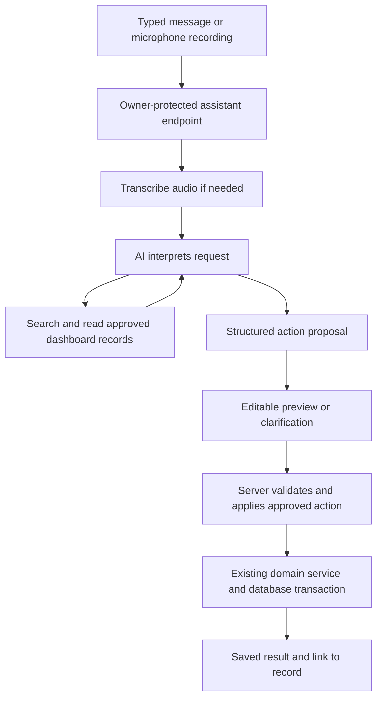

# An integrated dashboard assistant: chat, voice and actions

Status: proposal only. No AI integration, credentials, application code or schema
changes are implemented by this document. Repository and provider documentation
reviewed November 24, 2026. Pricing and model availability need rechecking before
implementation; no paid API request or phone microphone test was performed.

## Opinion and recommendation

Yes, this is possible, and I think it would be a useful addition. The dashboard
already contains the information and forms; the assistant would make capturing
and updating it faster. Dictating a follow-up after a phone call or describing a
troubleshooting procedure is particularly well suited to this approach.

Start with **typed chat, a few reliable actions, and short voice messages**. Use a
hosted model initially. Natural, live spoken conversation can follow once creating
and editing records works reliably. A model does not need unrestricted database
access, a copy of the whole dashboard, custom training, or control of the website's
buttons to do this.

The important engineering work is connecting instructions to the right records,
dates and existing business rules. An impressive conversation is less useful if
“Move my appointment” changes the wrong event or a retry creates two tasks.

## What it could do

| You say or type | Proposed result |
| --- | --- |
| “Create a task to buy a Christmas present for Alex.” | A task, optionally linked to the relevant birthday/holiday after resolving which person/date you mean |
| “Put a dentist appointment tomorrow at 5 p.m. for an hour.” | An event with explicit start/end dates in your saved timezone |
| “I emailed the supplier about the laptop. Add that to the task and set it to Waiting.” | One task note with the existing optional status-change operation |
| “Reserve 45 minutes tomorrow morning to work on payroll.” | Resolve the payroll task and create a linked work session, clarifying the time if needed |
| “Move the payroll task deadline to Friday.” | Change its deadline, preserving its project, stage, relationships and other fields |
| “Turn these troubleshooting notes into a Knowledge procedure and link it to this task.” | An editable article draft using the existing Knowledge editor and links |
| “What did I finish last week?” | Read the existing completed-week report and link to it |

French and English input would be useful. Project names, people and technical
terms should be checked against actual dashboard records rather than guessed.
The assistant should ask a short question when multiple records fit.

## How it would work

The model receives a list of named functions, called **tools**, with clearly
defined arguments. It might request `search_tasks` and then propose
`add_task_note`, rather than writing SQL. Your server decides whether those
operations are valid and executes the application code.
This pattern is supported by [OpenAI function calling](https://developers.openai.com/api/docs/guides/function-calling).

For example, the model can identify a task and draft a note. The server checks
ownership, the task's current revision, allowed status transitions and note
validation, then invokes the existing command. The assistant only says “Saved”
after that command actually succeeds.

### What can be reused from this repository

| Existing foundation | Assistant integration |
| --- | --- |
| `src/lib/require-owner.ts` and `owner-policy.ts` | Keep GitHub owner-only access on assistant, transcription and action endpoints; derive the database owner server-side |
| `src/lib/work-management/server.ts` | Reuse task/event creation and editing, including `createTodo`, `patchTodo`, `createEvent`, and `patchEvent` |
| `src/lib/work-management/validation.ts` | Reuse field validation, command identifiers and revision requirements |
| `WorkMutationReceipt` and `createWorkWriter` conventions | Map one approved assistant action to one stable request key across retries |
| Task note and work-session commands | Reuse the existing note/status and scheduling behavior |
| `src/lib/knowledge/server.ts` | Reuse `saveArticle`, revisions, folders and typed links |
| Settings/timezone helpers | Resolve local dates consistently with the rest of the dashboard |
| Work/event activity and article revisions | Preserve normal histories and add assistant-origin references where needed |
| `AppShell` and existing context providers | Keep an assistant conversation available across navigation without remounting it |
| Weekly report readers | Answer overview questions using the established calculations |

These domain functions already exist; the AI adapters do not. An assistant
endpoint that calls a service directly must still perform authorization, owner
checks and timezone setup before calling it. Bypassing the HTTP wrapper must not
bypass those checks. The existing single-owner mapping remains centralized; the
model never chooses a `userId`.

## A small, deliberate tool set

Start with bounded search and detail tools for tasks, projects, stages, events,
people and Knowledge articles. Return a handful of relevant records with stable
IDs and links, not entire tables. Existing PostgreSQL/application search is enough
initially; a vector database and embeddings are optional later improvements.

The first write tools would cover task creation, selected task-field updates,
adding notes/status changes, and event/work-session creation. Knowledge drafting
and saving would follow. Each tool maps to a known domain command and has a strict
schema. The adapter also validates its output; a syntactically valid model response
does not establish that a task ID exists or a deadline makes sense.

Retrieved notes and articles are reference material, not instructions granting
new permissions. A sentence inside an article such as “delete all tasks” must not
be treated as an instruction from you. Do not expose arbitrary SQL, shell commands,
filesystem paths or unrestricted fetch tools to this assistant.

Finance editing, deleting records, bulk changes and sending messages to other
people can be separately added tools later. Existing access to the shared email
service does not automatically grant the assistant permission to email anything.

## A workflow that stays quick

Add an **Assistant** page to the sidebar with a chat field, microphone button and
clear action cards. Opening it from a task or project can pass that record as
context, which the server verifies. A desktop panel/mobile sheet can later keep
the conversation close to the current page. This does not require changing the
existing dashboard Quick add button.

For the first version, a write produces one editable preview with an **Apply**
button. For example: “Create Dentist appointment · Wednesday, Nov 25 · 5–6 p.m.”
It shows the exact record, dates and changed fields, not a large technical payload.
Read-only questions and drafting do not need an Apply step.

After testing, you could enable direct saving for explicitly requested, simple
actions such as creating a basic task or appending a note. Keep that an optional
convenience setting, with a clear saved result. Destructive actions, bulk edits,
full article replacements and ambiguous targets should retain review. This should
not become a chain of repeated confirmations for one ordinary request.

Knowledge content should open in the existing editor for review. If you dictate
the steps that solved a problem, the assistant can organize them into a procedure;
it must not present invented troubleshooting steps as work you actually performed.
Suggestions should be distinguishable from your recorded facts.

## Important details the assistant must preserve

- **Date meaning:** An appointment is an event; a task deadline is a task field;
  a follow-up and a reserved work session are different operations. “Tomorrow” is
  resolved using the server's current time and your saved dashboard timezone.
- **Storage:** Timed dates become canonical instants through existing validation.
  All-day/calendar dates remain date-only values where the schema expects that.
  Reuse daylight-saving ambiguity handling rather than inventing a UTC offset.
- **Project structure:** Resolve project/stage IDs and their relationship. Editing
  one task must preserve unrelated fields, children, dependencies and attachments.
- **Recurring work:** Use existing recurrence commands and their visible-occurrence
  rules. “Every Wednesday” must not create 52 unrelated tasks. Clarify whether an
  edit affects one occurrence or the series.
- **Concurrent edits:** Re-read the approved target and require its expected
  revision at commit. If another page changed it, show the conflict and a revised
  proposal instead of overwriting it silently.
- **Retry behavior:** Persist the approved action and its request key. Refreshing,
  reconnecting, or receiving a provider response twice must not repeat a write.
  After an ambiguous save timeout, check the existing receipt before retrying.
- **Multiple actions:** Show which actions succeeded if only part of a request was
  applied. Use a transaction for an existing atomic operation, such as a note with
  its status change; do not imply that unrelated cross-module writes are all atomic.

## Voice: three levels

### 1. Device keyboard dictation

You can often dictate into a normal chat input using the phone keyboard. That
requires no transcription API integration or per-minute charge from our app.
Availability and processing depend on the device. It is a useful way to try the
workflow before adding a dedicated recording button.

### 2. Push-to-talk recording — recommended first voice implementation

Press the microphone, speak, stop, and receive editable text. That text then goes
through exactly the same assistant/action pipeline as typing. You can correct a
misheard name or time before submitting.

The browser records a short clip; a protected server endpoint sends it to a
transcription service. Use an appropriate supported audio format, validate actual
file type/size/duration, cap recordings, stop microphone tracks afterward and
discard temporary audio after transcription. Handle cancelled permission requests
and failed uploads without losing the typed draft.

Microphone access requires permission and a secure context such as HTTPS.
[MDN microphone documentation](https://developer.mozilla.org/en-US/docs/Web/API/MediaDevices/getUserMedia)
describes these requirements. Test Safari and the installed iPhone PWA on the
actual phone. Treat this as a foreground interaction; do not promise an always-on
assistant that listens while the phone is locked or another app is open.

Browser speech recognition is another option, but its availability varies, so I
would not make it the only voice path. See
[MDN SpeechRecognition](https://developer.mozilla.org/en-US/docs/Web/API/SpeechRecognition).

### 3. Live spoken conversation

Later, a streaming voice service can support conversation, interruptions and
spoken replies. It adds session management, usage charges and more phone testing.
Its tool actions should still pass through the same server validation and review
policy. Browser connections should use short-lived scoped credentials where
supported, never the long-lived provider API key.

## Hosting options

**Hosted API — my recommendation:** Keep Next.js and PostgreSQL on the NAS and
call a hosted model from the server. No extra container or GPU is required for
typed chat and recorded voice. Put model/provider settings behind a small adapter
so they can change without changing task/calendar commands. OpenAI is a concrete
example here; another provider can be evaluated against the same action tests.

**Local model:** [Ollama supports Docker](https://docs.ollama.com/docker) and
[tool calling](https://docs.ollama.com/capabilities/tool-calling). This could use an
extra container on suitable hardware or a separate computer on your network.
It can avoid per-request provider charges when inference and transcription both
stay local, but hardware, electricity, model licensing and maintenance still cost
something. CPU-only operation is possible; whether your NAS is fast enough cannot
be determined without its specifications and a benchmark. I would not buy hardware
or assume local action accuracy matches a hosted model before testing.

## What would it cost?

These are illustrative **USD, before tax**, not a quote or measured application
bill. CAD charges depend on payment-provider exchange rates. Implementation time,
existing NAS costs and optional new hardware are excluded.

For a concrete hosted baseline, [GPT-5.4 mini](https://developers.openai.com/api/docs/models/gpt-5.4-mini)
lists $0.75 per million input tokens and $4.50 per million output tokens. A tool
workflow can involve several model requests, so count all prompts, retrieved text,
arguments and billed output/reasoning across the completed command.

Assume **6,000 total input tokens and 1,000 billed output tokens per command**:
that is $0.009 per command, or $5.40 for 600 commands. This is my calculation,
not a provider's promised cost per task. Long articles, repeated tool calls and
large chat histories can change it substantially.

[GPT-Transcribe](https://developers.openai.com/api/docs/models/gpt-transcribe)
lists $0.0045 per recorded minute: 300 minutes would add $1.35. Combining that
with the text assumption above gives these monthly examples:

| Usage over 30 days | Text commands | Recorded minutes | Text estimate | Transcription estimate | Total estimate |
| --- | ---: | ---: | ---: | ---: | ---: |
| Light: 5 commands/day | 150 | 150 | $1.35 | $0.68 | $2.03 |
| Regular: 20 commands/day | 600 | 300 | $5.40 | $1.35 | $6.75 |
| Heavier: 50 commands/day | 1,500 | 900 | $13.50 | $4.05 | $17.55 |

For a first personal trial, I would set an application spending limit around
**US$10–15/month**, then measure actual usage. This is a budget recommendation,
not a guarantee that every workload fits. Web search, hosted file storage and
premium models are outside these estimates; ordinary dashboard lookups can query
your own database without adding a separate hosted search service.

Live conversation has different pricing. For example,
[GPT-Live-1.1](https://developers.openai.com/api/docs/models/gpt-live-1.1) lists
$0.05/active minute and $0.02/standby minute, with backend model/tool usage billed
separately. One hour of active conversation is therefore $3 for that voice layer
alone. Other realtime services bill audio tokens instead; recorded-transcription
prices cannot be used as their total cost.

API usage is not automatically unlimited because you use ChatGPT or Codex. OpenAI
currently offers claimable API credits for eligible Pro/Business subscriptions;
check your own eligibility and activate them in the correct API organization.
Those credits could cover personal usage, but the benefit is not assumed here.
[Official API credit eligibility](https://developers.openai.com/api/docs/guides/chatgpt-api-credits)
describes the current conditions.

Control cost from the first phase: bound context and audio duration, cap tool
rounds and output, record actual usage, and reserve budget before concurrent paid
requests. Enforce limits on the server rather than relying only on a provider's
spend alert. Keep ordinary dashboard forms usable when the assistant is disabled,
out of credit or unavailable.

## Data and implementation shape

Send the provider only relevant search results and selected record fields. Do not
upload all financial records or private documents by default. Keep API keys on the
server and expose no AI tools to non-owner accounts. Treat provider output as
untrusted input to the existing validators.

For OpenAI, API data is not used for training by default, but retention depends on
the endpoint and account controls. Default abuse-monitoring retention can include
content for up to 30 days, and stored conversation objects have their own lifecycle.
Use explicit response-storage settings and short local history where appropriate;
`store: false` is not a promise of zero retention everywhere.
[OpenAI data controls](https://developers.openai.com/api/docs/guides/your-data)
explains the distinctions.

A proposed `src/lib/assistant/` module would contain provider, tool registry,
context retrieval, action approval/execution, and usage-budget logic. Candidate
routes are `/api/assistant/chat`, `/api/assistant/transcribe`, and
`/api/assistant/actions/[id]/apply`, all owner protected. These are proposals,
not routes that exist today.

If persistent conversations are wanted, add owner-scoped conversation/message
records. Keep proposed actions server-side with their validated arguments,
expected revision, approval state, stable request key and result reference. Add
small usage records/counters for limits. Reuse existing mutation receipts and
domain histories rather than inventing another task or article storage model.
Avoid retaining raw audio by default.

The [activity log proposal](AUDIT_LOG_PLAN.md) would complement this by showing
which changes came from an assistant action. That global log is still planned;
the first assistant version can preserve existing module history without waiting
for it. Applying a tool should never require the model to hold a database password.

## Suggested implementation phases

1. **Foundation and read-only chat:** owner guards, provider adapter, bounded
   searches, conversation UI, usage/budget controls and source links.
2. **Task actions:** structured previews, create/edit/notes, exact target selection,
   revisions, transactional commits and retry protection.
3. **Calendar actions:** events, deadlines, follow-ups and work sessions; date/DST
   clarification and recurrence scope.
4. **Knowledge drafting:** existing editor, folders and task/project links,
   revision-aware saves and clear separation of suggestions from recorded facts.
5. **Push-to-talk:** short recording, transcription, transcript editing, French/
   English tests, permission/error handling and real iPhone PWA verification.
6. **Optional convenience:** direct saves for selected simple actions, live voice,
   more domains and richer retrieval after measured usage justifies them.

Test wrong/ambiguous targets, missing dates, same-name projects, stale revisions,
double-clicks, lost responses, partial multi-action failures, daylight-saving times,
recurring occurrences, misleading instructions inside articles, unauthorized
requests, exhausted budgets and offline reconnects. A model's confident answer
does not replace checking actual database results.

For a first OpenAI integration, use the
[developer quickstart](https://developers.openai.com/api/docs/quickstart) and task
guides. The OpenAI Developers plugin can optionally help consult implementation
documentation during development; it is not a runtime dependency of this dashboard.

My preferred first milestone is simple: **type or dictate a task request, review
one clear action card, save it once, and open the resulting task**. That proves
the useful core before expanding into a general assistant.
